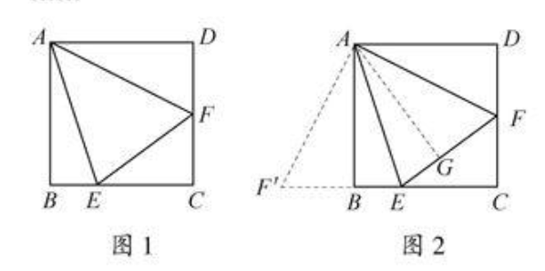
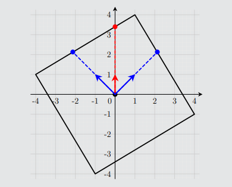

**提示 1：** 本质上你的选择是啥？

**提示 2：** 找性质。

本质上，你第一次查询的方向是哪一个都完全等价，因为给的正方形可以是任意方向。

而第二次查询的方向本质上重要的只有跟第一次查询的方向的夹角。

所以关键就在于找一个夹角，使得边长可以通过两次查询的结果得出。

也就是说，我们要让查询的这两个方向，无论是否包含顶点，都能得出一样的边长。

在查询方向之间不包含顶点时，你相当于要求底边的高，正方形的边长是这个高的两倍。

所以我们要在包含顶点的时候，这个高仍然不变。什么角度可以满足这个条件呢？

这里是你初中选全等三角形的时候可能遇到的图：



$45$ 度的情况下，三角形 AEF' 和三角形 AEF 全等，因此高相等。所以取这个角度，用余弦定理求第三条边，再用面积法求第三条边上的高，即可确定正方形边长。

当然，这是官方题解给的图，利用的也是对称性，发现高一样：



但如果你看样例的话，也可以发现是 $45$ 度夹角就行，所以从这个层面来讲，我觉得样例不该这么出，实在是降低了很多乐趣。

时间复杂度为 $\mathcal{O}(1)$ 。

### 具体代码如下——

Python 做法如下——

```Python []
def main(): 
    t = II()
    
    for _ in range(t):
        print('? 1 0', flush=True)
        d1 = float(I())
        print('? 1 1', flush=True)
        d2 = float(I())
        
        d = math.sqrt(d1 * d1 + d2 * d2 - d1 * d2 * math.sqrt(2))
        h = d1 * d2 * math.sqrt(2) / 2 / d
        print(f'! {round(4 * h * h)}', flush=True)
```

C++ 做法如下——

```cpp []
int main() {
	ios_base::sync_with_stdio(false);
	cin.tie(nullptr);

	int t;
	cin >> t;

	cout << fixed << setprecision(0);

	while (t --) {
		long double d1, d2;
		cout << "? 1 0" << endl;
		cin >> d1;
		cout << "? 1 1" << endl;
		cin >> d2;

		long double d = sqrtl(d1 * d1 + d2 * d2 - sqrt(2) * d1 * d2);
		long double h = d1 * d2 * sqrtl(2) / 2 / d;

		cout << "! " << 4 * h * h << endl;
	}

	return 0;
}
```